# Option B preliminary tests: does democratic erosion reduce data dissemination?

**Status:** exploratory tests, 5 November 2026. These are not the paper's final models. They were run to decide whether Option B ("backsliding at the center") can carry the revised paper, and in what form.

**In one sentence:** after a country starts autocratizing, the part of statistical capacity that drops is **dissemination** (what the government releases and how openly), not the capacity to **produce** data. This shows up in two separate measures and periods (SPI Pillar 2 for 2016-2024, HRV transparency index for 1990-2010), but the samples are small, the effects are only significant two to three years after onset, and they are weaker after 2008.

---

## Contents

1. [Proposed direction](#1-proposed-direction)
2. [What the tests found](#2-what-the-tests-found)
3. [Design: what the code does](#3-design-what-the-code-does)
4. [Data](#4-data)
5. [Results, step by step](#5-results-step-by-step)
6. [Open questions for discussion](#6-open-questions-for-discussion)
7. [Other considerations and limitations](#7-other-considerations-and-limitations)
8. [Proposed next steps](#8-proposed-next-steps)
9. [How to run and file index](#9-how-to-run-and-file-index)

---

## 1. Proposed direction

**Core question.** Does democratic erosion reduce governments' data dissemination, and does the reduction grow with the size of the democratic decline?

**Hypotheses (draft for Step 1.4 of the revision).**

| | Hypothesis | Tested so far by |
|---|---|---|
| H1 | **Dissemination falls** after the onset of an autocratization episode, relative to countries that are not autocratizing. | SPI Pillar 2 (Figs 3, 5, 7); HRV and HRV2 (Figs 11-13) |
| H2 | **Production capacity does not fall**, at least in the short run: data sources and statistical infrastructure stay level. Eroding governments restrict what they release more than what they can produce. | SPI Pillars 4 and 5 (Figs 3, 5) |
| H3 | **Dose-response (core element):** the drop in dissemination is larger where democracy falls further. | Not yet tested; design in [Section 8](#8-proposed-next-steps). Fig 14 shows why it matters. |

**Secondary.** The current draft's capacity-to-SDG link becomes a short secondary section.

**What changes from the current draft.** The paper narrows from "democracy and statistical capacity" (levels across countries) to "democratic erosion and data dissemination" (change within countries over time). The data and most of the code carry over. The framing, hypotheses and models sections need rewriting. The assessment of how much is kept is in the Draft 3 doc tab "Options A, B, C: Novelty and Feasibility".

---

## 2. What the tests found

| # | Finding | Evidence | Strength |
|---|---|---|---|
| 1 | Overall capacity indices barely move after onset. | SCI overall: -1.5 points at t+1, n.s. SPI overall: flat (Figs 1-2) | Clear null |
| 2 | Among SPI pillars, **only Pillar 2 (data services, i.e. dissemination) falls steadily**. Pillar 5 (infrastructure) rises, and Pillars 1 and 4 stay flat. Pillar 3 (products) dips briefly. | Pillar 2: -2.7, -3.4, -4.6, **-6.0** points at t0 to t+3; t+3 95% CI [-11.9, -0.2]. 22 treated countries (Figs 3, 5) | Suggestive. Significant only at t+3 |
| 3 | The Pillar 2 drop survives dropping the 2016 SPI wave (likely method break). | 15 treated: **-2.5** at t+2 (CI [-4.9, -0.1]), -5.9 at t+3 (Fig 7) | Suggestive |
| 4 | No single Pillar 2 channel drives it. Microdata access (2.4) falls most; ODIN openness (2.2) is flat. | All sub-indicators n.s. (Fig 8) | Weak |
| 5 | **The same pattern appears before 2016** in an independent measure. HRV covers all income groups, but all 25 treated countries were low or middle income at onset. | HRV v1, onsets 1994-2007: **-0.27** at t+2 (CI [-0.50, -0.04]). That is about 0.8 of a typical year-to-year change. Clean pre-trends (p = 0.44) (Fig 11) | Moderate |
| 6 | In the updated HRV2, the full-sample drop is smaller and not significant. It is concentrated in the original countries and the pre-2008 onsets. | HRV2 full: -0.14 n.s. Original 125 countries: **-0.25** at t+2, **-0.23** at t+3 (both significant). 2008-2012 onsets: flat, 12 cases (Figs 12-13) | Mixed |
| 7 | SCI dimensions show nothing. SCI does not measure dissemination and excludes high-income countries. | All n.s.; periodicity fails pre-trend test (p = 0.04) (Figs 9-10) | Clear null |
| 8 | Post-2008 episodes last longer and decline more slowly per year, but the evidence is thin. | Median episode length 6 vs 4 years; median yearly decline -0.030 vs -0.043; 15 onsets (Fig 14) | Weak |

**Bottom line.** The direction is supported but not yet established. The most credible single result is HRV v1 (finding 5). The SPI Pillar 2 result (finding 2) has the right shape but weaker pre-trends. The dose-response test (H3) is the next and most important step. It also tests whether slower post-2008 erosion explains why the HRV2 effect is weaker.

---

## 3. Design: what the code does

**Treatment.** We use the onset of a V-Dem autocratization episode (Episodes of Regime Transformation, ERT, `aut_ep`). Onset is the first year of an episode. Onsets are computed on the full 1900-2024 V-Dem series before restricting to 1990 onward, so a country already mid-episode in 1990 is not counted as a new onset.

**Stacked event study** (Cengiz, Dube, Lindner & Zipperer 2019 style), in `01_helpers.R`:

1. **Build one block per onset year *g*.** Each block covers years *g - pre* to *g + post*.
   - *Treated:* countries with an onset in *g* that were not in an episode during the pre-window.
   - *Clean controls:* countries that are in no episode at any point in the window.
2. **Stack the blocks and estimate.** Regress the outcome on treated × event-time dummies. Include block-by-country and block-by-year fixed effects. Cluster standard errors by country.
3. **Reference year.** The year before onset (-1) is fixed at 0. Each coefficient is the treated-control gap in year *k*, minus the gap in year -1.
4. **Pre-trend test.** A Wald test asks whether all pre-onset coefficients are jointly 0.
5. **Raw trends.** Every event study is paired with plain averages for treated and controls by event time. This is a visual parallel-trends check.

**Why stacked.** Treatment is staggered. A standard two-way fixed effects model would use already-treated countries as controls, which biases the estimates. Stacking with clean controls avoids that.

**Software.** Base R `lm()` with `sandwich::vcovCL()` for clustered SEs. Some packages could not be installed in the cloud environment used for these tests: `fixest`, `did` (Callaway & Sant'Anna), `HonestDiD` and `PanelMatch`. They should be run locally as robustness checks ([Section 8](#8-proposed-next-steps)).

**How to read every figure.** Each figure has a title, the question it answers, the sample (data years, onset cohorts, window) and a caption explaining how to read it. In all of them:

- The dashed line marks onset.
- The shaded band is a 95% confidence interval.
- Points below 0 after the dashed line mean the outcome fell relative to controls.

---

## 4. Data

All inputs are in `data/` and were built by `00_prepare_inputs.R`.

| File | Measure | What it captures | Years used | Countries | Income groups | Role |
|---|---|---|---|---|---|---|
| `vdem_ert_episodes.csv` | V-Dem ERT episodes + electoral democracy index (`v2x_polyarchy`) | Autocratization episodes (start, end); democracy level | 1990-2024 (onsets from the full series) | 183 | All | Treatment |
| `spi_index.csv` | World Bank Statistical Performance Indicators: overall, 5 pillars, Pillar 2 sub-indicators | Pillar 2 = data services (dissemination). 2.1 IMF data standards, 2.2 ODIN openness, 2.4 microdata access | 2016-2024 (pillar scores start 2016) | 188-191 | All | Main post-2016 outcome (Pillar 2) and production-side contrast (Pillars 4-5) |
| `hrv_v1.csv` | HRV transparency index, original (Hollyer, Rosendorff & Vreeland) | Whether governments report data to the World Bank (WDI): data disclosure | 1990-2010 | 125 (27 high, 21 upper-middle, 35 lower-middle, 42 low income) | All | Main pre-2016 outcome |
| `hrv2.csv` | HRV2, 2024 update (Hollyer, Ge, Rosendorff & Vreeland, "Measuring Transparency, Again", draft) | Same concept, re-estimated, 24 added countries from 1993 | 1990-2015 | 149 | All | Robustness for HRV v1 |
| `sci_dimensions.csv` | World Bank Statistical Capacity Indicator: overall + methodology, source data, periodicity & timeliness | Production and timeliness of core statistics | 2004-2020 | 154 | **Low and middle income only** | Earlier benchmark (null) |

**Sources.**

- V-Dem ERT and SCI come from the repository (`data/input_data/ert.csv`, `SCI_All_Dim_TS.csv`).
- SPI comes from the World Bank SPI GitHub repository (`03_output_data/SPI_index.csv`).
- HRV v1 comes from the QoG Standard Time-Series dataset (January 2026, `hrv_index`). These values match the QoG HRV dataset download.
- HRV2 comes from the authors' file `HRV2ExpandedCntriesExtracted.RData` (object `TransparencyData`). It is not on QoG.

**Measures considered and set aside.**

- **ODIN as a standalone outcome.** The editions are uneven, and the 2015 edition covers only about 3 high-income countries. The categories also changed between editions. Scores use 5-10 year windows, so they react slowly. ODIN enters through SPI 2.2 instead.
- **IMF data standards (SDDS / e-GDDS).** Almost every move is upward, and there has been no nonobservance since 2012, so the measure barely varies. It could serve as a control at most.
- **Splicing SCI and SPI into one series.** They measure different things and cover different country sets.

---

## 5. Results, step by step

Step numbers match the sections in `02_run_tests.R`. All estimates are in `outputs/tables/summary_all_tests.csv`, where `*` marks a 95% CI that excludes 0.

### Step 1. Overall indices: little movement

SCI overall dips about 1-1.5 points after onset, but not significantly, and the raw trends show controls rising before onset while treated countries stay flat. SPI overall is flat.

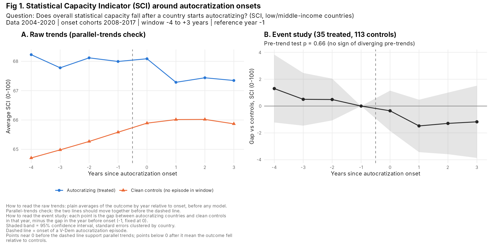
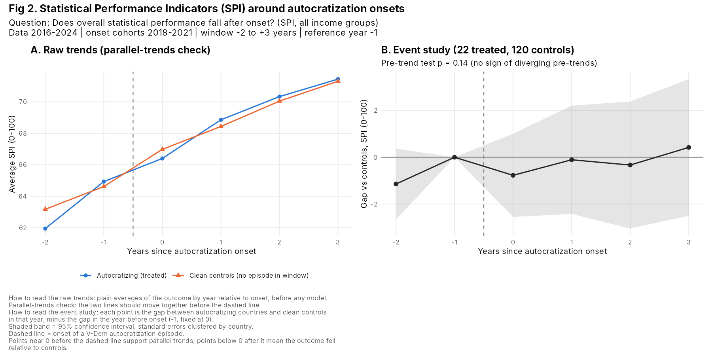

### Steps 2-3. Which pillar moves? Dissemination does; infrastructure does not

Same sample design for every pillar: 22 treated, about 120 controls, onset cohorts 2018-2021.

| Pillar (0-100) | t0 | t+1 | t+2 | t+3 | Pre-trend p |
|---|---|---|---|---|---|
| 1 Data use | -0.4 | 1.0 | -0.1 | 2.2 | 0.24 |
| **2 Data services** | **-2.7** | **-3.4** | **-4.6** | **-6.0*** | 0.13 |
| 3 Data products | -2.1* | -2.4 | -1.6 | -1.5 | 0.53 |
| 4 Data sources | 0.4 | 0.7 | 1.0 | 1.8 | 0.37 |
| 5 Data infrastructure | 1.2 | 3.6 | 3.7 | 5.4 | 0.43 |

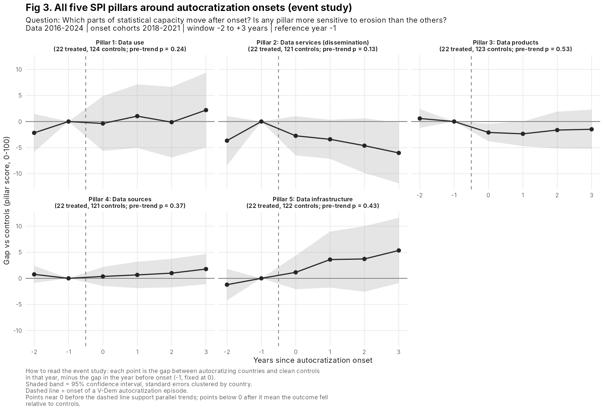
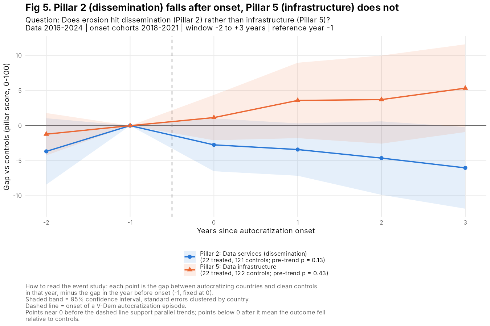

### Step 4. Parallel trends: tests pass, but they are weak and the raw trends need a closer look

- **Pre-trend tests pass.** All pillars pass with 2 pre-years and with 3 pre-years (all p > 0.1), but these tests have little power (1-2 leads, 15-22 treated countries).
- **The Pillar 2 raw trends show a pre-onset surge.** Treated countries rose faster than controls just before onset, then plateaued. Part of the later "drop" may therefore be **mean reversion**.
- **The Pillar 3 dip is controls catching up**, not treated countries falling.

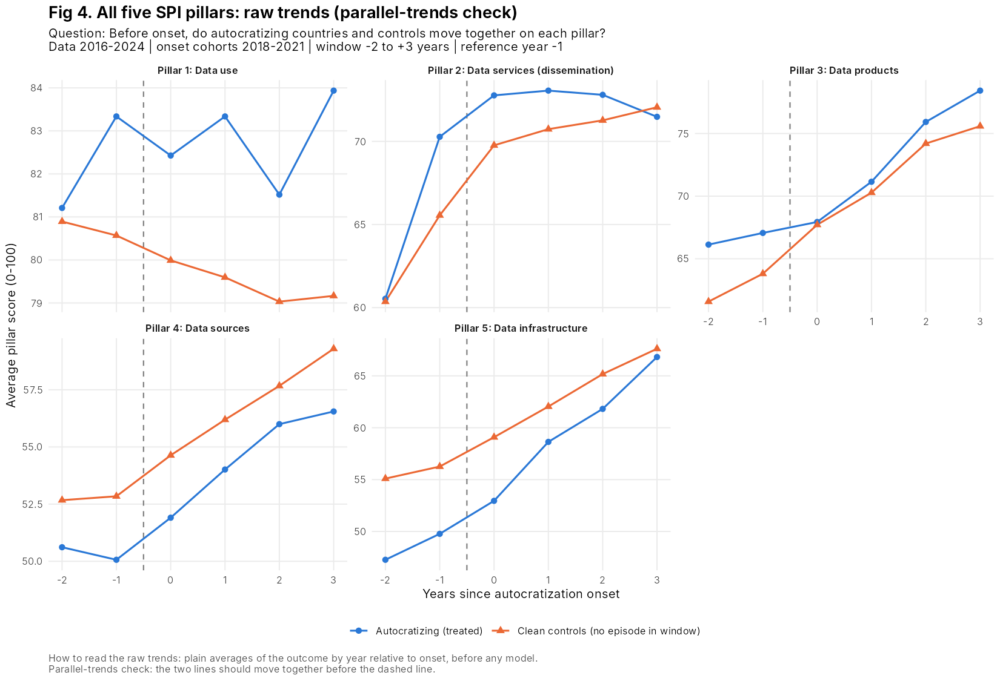
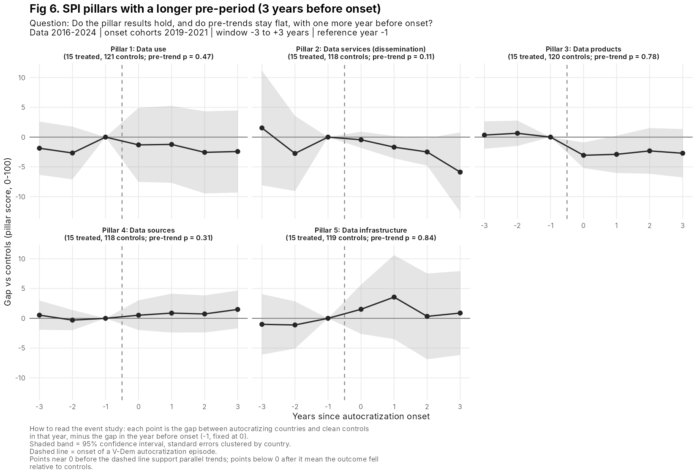

### Step 5. Without the 2016 SPI wave, the Pillar 2 drop holds

2016 values look like a method break: the Pillar 2 average is 47 in 2016, 56 in 2017 and 68 in 2018, while Pillar 5 barely moves. Dropping 2016 leaves 15 treated countries. Pillar 2 still falls (-2.5 at t+2, significant; -5.9 at t+3), and Pillar 5 does not.

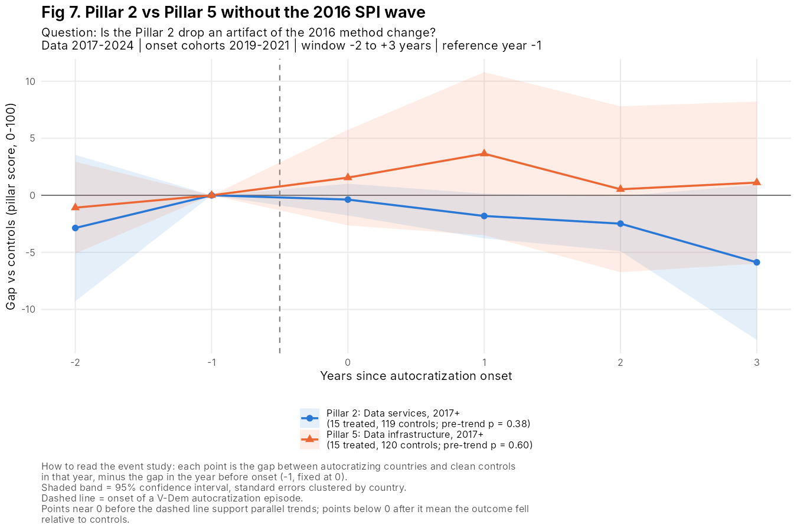

### Step 6. Inside Pillar 2: no single channel is significant

Microdata access (2.4) falls the most: -0.15 on a 0-1 scale by t+3, n.s. ODIN openness (2.2) is flat. IMF data standards (2.1) barely vary.

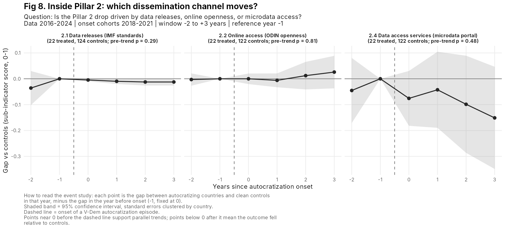

### Step 7. SCI dimensions: no effect

No SCI dimension falls significantly. Periodicity & timeliness fails the pre-trend test (p = 0.04). SCI measures how often surveys and censuses happen, not how openly data are released, and it excludes high-income countries.

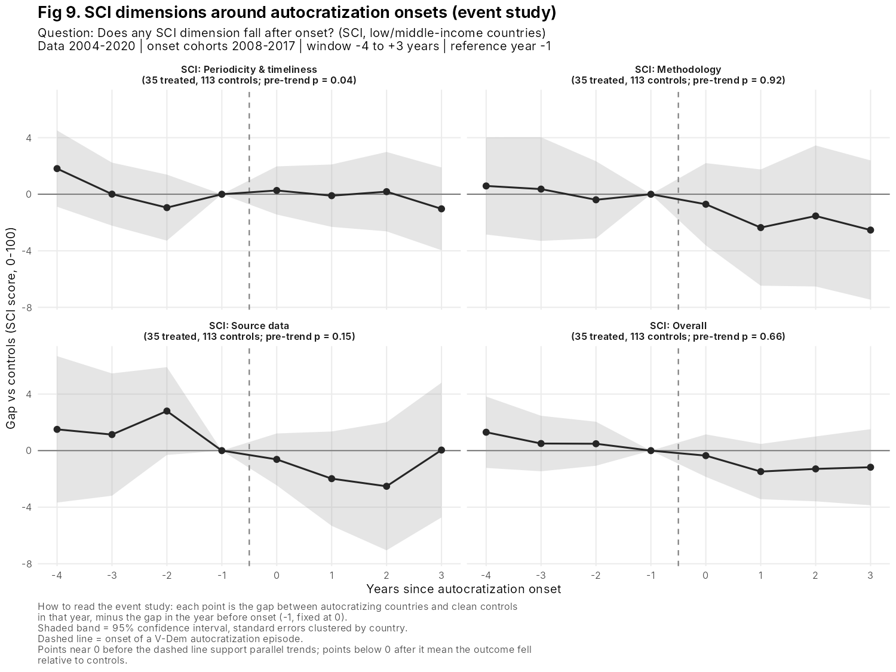
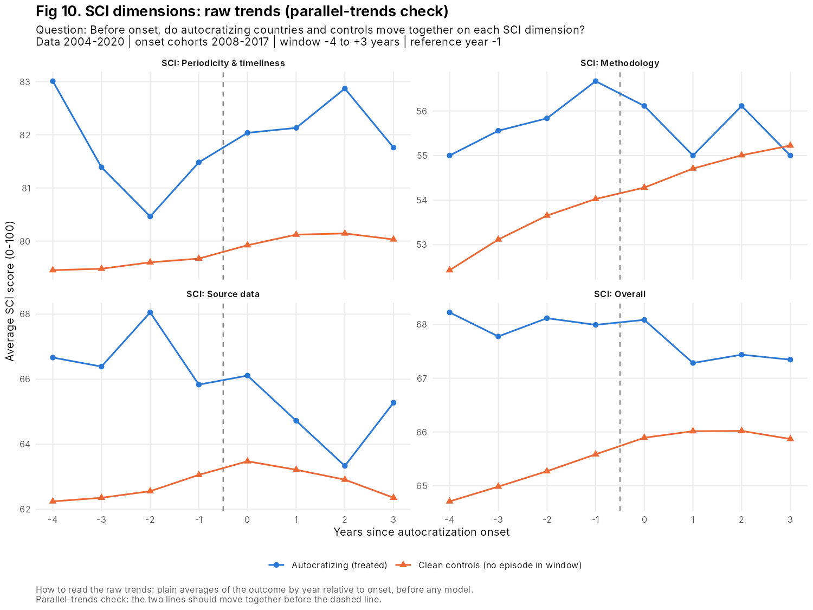

### Step 8. Before 2016: HRV transparency index replicates the dissemination drop

25 treated countries and 123 controls, with onsets 1994-2007. Raw trends are close to parallel before onset (pre-trend p = 0.44). After onset, disclosure falls: -0.27 at t+2 (CI [-0.50, -0.04]) and -0.24 at t+3. This is the cleanest result so far. High-income countries appear only as controls here: none of the 25 treated countries was high income at onset.

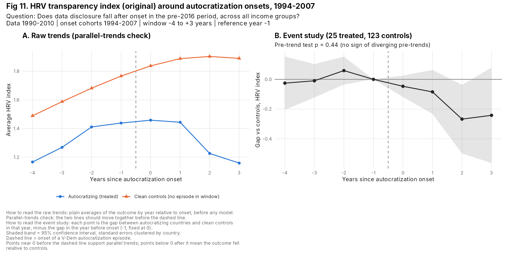

### Steps 9-10. HRV2: weaker overall, concentrated in the original countries and earlier onsets

| HRV2 sample | Treated | t+2 | t+3 | Pre-trend p |
|---|---|---|---|---|
| Full, onsets 1994-2012 | 38 | -0.14 | -0.08 | 0.92 |
| Onsets 1994-2007 | 31 | -0.17 | -0.09 | 0.95 |
| Onsets 2008-2012 | 12 | -0.05 | -0.04 | 0.54 |
| Original 125 countries, onsets 1994-2007 | 25 | **-0.25*** | **-0.23*** | 0.96 |

HRV v1 and HRV2 correlate at 0.77 for the same country-years. The dilution comes from two sources: the 24 added countries, and the 2008-2012 onsets.

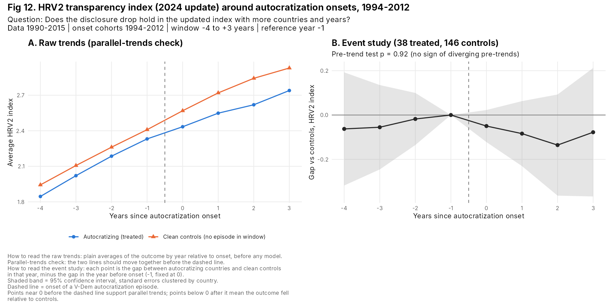
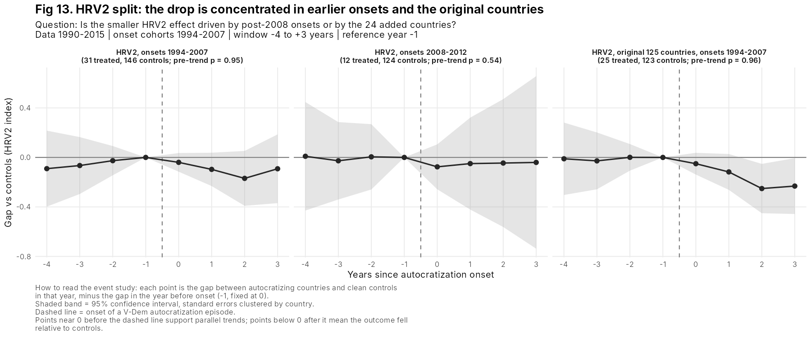

### Step 11. Why might post-2008 onsets look different? Erosion speed and length

| Onsets | n | Change in democracy index by year 1 | by year 3 | Median episode length | Episodes ≤ 2 years | Episodes ≥ 10 years | Median yearly decline |
|---|---|---|---|---|---|---|---|
| 1994-2007 | 37 | -0.090 | -0.104 | 4 | 30% | 19% | -0.043 |
| 2008-2012 | 15 | -0.110 | -0.072 | 6 | 33% | 33% | -0.030 |

**The post-2008 group is not uniformly "slower".** It has a similar share of short, sharp drops that partly reverse within 1-2 years, for example Guinea-Bissau, Niger and Nepal. It also has more long episodes with slow yearly decline, for example Serbia, Bangladesh, Indonesia and Haiti. Both kinds are hard to see in a 3-year window.

**This argues for measuring the size of the democratic decline (H3) rather than only the onset.** The pattern is consistent with the literature on gradual backsliding through executive aggrandizement (Bermeo 2016; Lührmann & Lindberg 2019), but 15 onsets is too few to rest on.

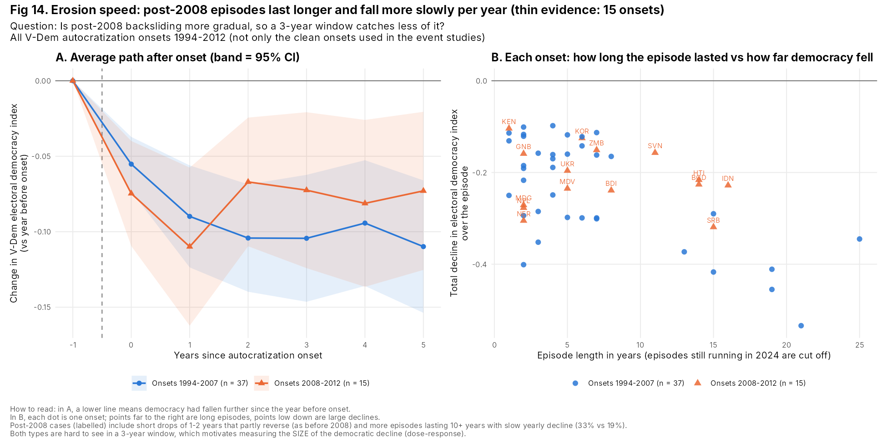

### Step 12. Who is in the SPI tests?

| Group | Countries |
|---|---|
| Countries with SPI Pillar 2 scores | 190 |
| Not in V-Dem (mostly small states, e.g. Bahamas, Belize, Samoa, Tonga) | 19 |
| In V-Dem | 171 |
| Used in the test (treated or clean control) | 143 |
| ...of which treated (clean onset 2018-2021) | 22 |
| Not used: onset in 2016-2017 or 2022+ (outside usable cohorts) | 11 |
| Not used: in an episode that began before 2016 (ongoing backsliders) | 17 |

---

## 6. Open questions for discussion

1. **Narrowing the claim.** Is moving from "statistical capacity" to "data dissemination" an acceptable contribution for the paper and the target journal? Does it answer the reviewers' concerns about the core question?
2. **Primary measure and period.** No single dissemination measure covers 1990-2024. The options are:
   - (a) two periods with two measures of the same dimension: HRV for onsets 1994-2007, SPI Pillar 2 for onsets 2018-2021;
   - (b) HRV only, with SPI as a check;
   - (c) SPI only, with HRV as a check.

   Option (a) gives the most cases but mixes instruments.
3. **HRV v1 or HRV2 as the main pre-2016 measure?** HRV2 is newer and larger, but the effect is weaker in it. Reporting both seems necessary. Which one leads?
4. **Pre-specifying the pillar grouping.** To avoid a post-hoc choice, fix the split before further tests. Should dissemination be Pillar 2 alone, or Pillars 2 + 3? Should production be Pillars 4 + 5? Where does Pillar 1 (data use) go?
5. **Treatment definition for the dose-response.** Options include:
   - total decline over the episode;
   - decline within the event window;
   - annual change in polyarchy;
   - specific V-Dem components closer to the mechanism, such as media freedom or government censorship.

   Which democracy measure fits the mechanism best?
6. **Window length.** Post-2008 erosion can be slow, so a 3-year post-window may miss it. SPI ends in 2024, so the window cannot be lengthened for recent onsets. Is that acceptable if the dose-response handles it?
7. **Ongoing backsliders.** 17 countries were already autocratizing before 2016 and are excluded by design. Should a continuous-treatment model bring them back in?
8. **Positioning.** How to frame against the closest work:
   - *Di Gennaro, Splendore & Ayromloo (2026, Economics of Governance):* cross-country levels, IV with settler mortality. This paper instead studies within-country change after erosion.
   - *Hollyer, Rosendorff & Vreeland (2011 onward):* democracy and transparency in levels. This paper instead studies erosion episodes, timing, and which capacity components move.

---

## 7. Other considerations and limitations

**Measurement**

- **HRV and SPI Pillar 2 measure different instruments of the same dimension.** HRV measures whether data are reported to the WDI, which is disclosure, not quality or timeliness. Pillar 2 measures data standards, openness and microdata access. Present them as same-dimension evidence from two periods, not as one series.
- **Pillar 2 jumps between 2016 and 2018** (average 47, 56, 68), most likely from changes in its components. Dropping 2016 helps, but the jump continues into 2018, so the 2018 onset cohort's pre-years fall inside it. Worth checking the SPI technical notes.
- **No single Pillar 2 channel is significant.** The aggregate drop may reflect several small moves rather than one mechanism. That needs explaining.
- **A possible pre-2016 production-side contrast** to HRV is the repository's `information_capacity.csv`: the information capacity index of Brambor, Goenaga, Lindvall & Teorell, 1750-2015, covering censuses, civil registers and statistical agencies. However, it moves slowly by construction, so a flat result would say little.

**Identification**

- **Mean reversion.** The Pillar 2 pre-onset surge could explain part of the drop. Possible fixes:
  - match on pre-onset levels and trends (`PanelMatch`);
  - bound violations of parallel trends (`HonestDiD`);
  - re-estimate with Callaway & Sant'Anna (`did`).
- **Anticipation.** Governments may cut dissemination before V-Dem dates the onset. The Pillar 2 lead at t-2 is -3.7 (n.s.).
- **Confounders.** Economic crises, conflict, coups, IMF programs and aid cuts can drive both erosion and data releases. Add controls or match on them.
- **Small samples and multiple outcomes.** 22 treated (SPI) and 25 (HRV v1). Significance appears only at t+2 or t+3, across many outcomes tested. Pre-specifying outcomes (question 4) limits the risk of reading noise.

**Sample and scope**

- **19 small states are not in V-Dem** and drop out of every test.
- **Few treated countries are high income.** In the SPI test, 4 of the treated countries were high income at onset (Korea, Mauritius, Greece, Romania). In the HRV v1 test, none were. High-income countries mostly serve as controls, so the results speak mainly to erosion in low- and middle-income countries.
- **Boundary with the separate "Politics of NAs" paper:** sector-level SDG data availability stays in that paper. This paper uses SPI, HRV and SCI only.

---

## 8. Proposed next steps

1. **Agree on the narrowed question and pre-specify outcomes.** This means the dissemination vs production grouping and the primary measure per period. This README is the draft spec.
2. **Build the dose-response test (H3).** Interact the post-onset dummies with the size of the democratic decline, measured continuously or in terciles. Alternatively, use local projections of dissemination on annual changes in the democracy index. The local-projections version also brings back ongoing backsliders and lets increases and decreases be compared. It tests whether slow post-2008 erosion explains the weaker HRV2 result.
3. **Run robustness checks locally:**
   - matching on pre-onset levels (`PanelMatch`);
   - `HonestDiD` sensitivity;
   - Callaway & Sant'Anna (`did`);
   - controls for GDP per capita, conflict and aid.
4. **Rewrite the draft's hypotheses (Step 1.4) and models section** around H1-H3. Keep the SDG link as a short secondary section.

---

## 9. How to run and file index

**Requirements:** R with `dplyr`, `tidyr`, `ggplot2`, `sandwich`, `lmtest` and `patchwork`. Run everything from the repository root (the folder with `stat_casualties_study.Rproj`).

```r
# Optional: rebuild data/ from the original sources (paths set at the top of the script)
source("testing_functions_n_mods/optionB_testing/00_prepare_inputs.R")

# Run every test (about 5-10 minutes); writes outputs/figures and outputs/tables
source("testing_functions_n_mods/optionB_testing/02_run_tests.R")
```

```
optionB_testing/
├── README.md                 this spec
├── 00_prepare_inputs.R       builds data/ from the original sources (only needed to refresh)
├── 01_helpers.R              settings, onset construction, event-study and plotting functions
├── 02_run_tests.R            runs Steps 1-12, one labeled section per test
├── data/                     every input the tests use (self-contained)
│   ├── vdem_ert_episodes.csv
│   ├── spi_index.csv
│   ├── sci_dimensions.csv
│   ├── hrv_v1.csv
│   └── hrv2.csv
└── outputs/
    ├── figures/              fig01-fig14 (each with title, question, sample, how-to-read caption)
    └── tables/
        ├── summary_all_tests.csv        one row per test: sample, pre-trend p, t0-t3 with 95% CI
        ├── event_study_estimates.csv    every coefficient from every test
        ├── pretrend_tests.csv           Wald pre-trend tests (incl. 3-pre-year SPI version)
        ├── erosion_speed_by_period.csv  Step 11 summary
        ├── erosion_speed_by_onset.csv   Step 11, one row per onset
        └── sample_accounting_spi.csv    Step 12
```

| Figure | Shows | Step |
|---|---|---|
| fig01 | SCI overall: raw trends + event study | 1 |
| fig02 | SPI overall: raw trends + event study | 1 |
| fig03 | All five SPI pillars: event studies | 2 |
| fig04 | All five SPI pillars: raw trends (parallel-trends check) | 4 |
| fig05 | Pillar 2 vs Pillar 5 on one plot (headline contrast) | 3 |
| fig06 | SPI pillars with 3 pre-onset years | 4 |
| fig07 | Pillar 2 vs Pillar 5 without the 2016 wave | 5 |
| fig08 | Pillar 2 sub-indicators (2.1, 2.2, 2.4) | 6 |
| fig09 | SCI dimensions: event studies | 7 |
| fig10 | SCI dimensions: raw trends | 7 |
| fig11 | HRV v1: raw trends + event study | 8 |
| fig12 | HRV2 full sample: raw trends + event study | 9 |
| fig13 | HRV2 split by period and country set | 10 |
| fig14 | Erosion speed and episode length, 1994-2007 vs 2008-2012 onsets | 11 |
